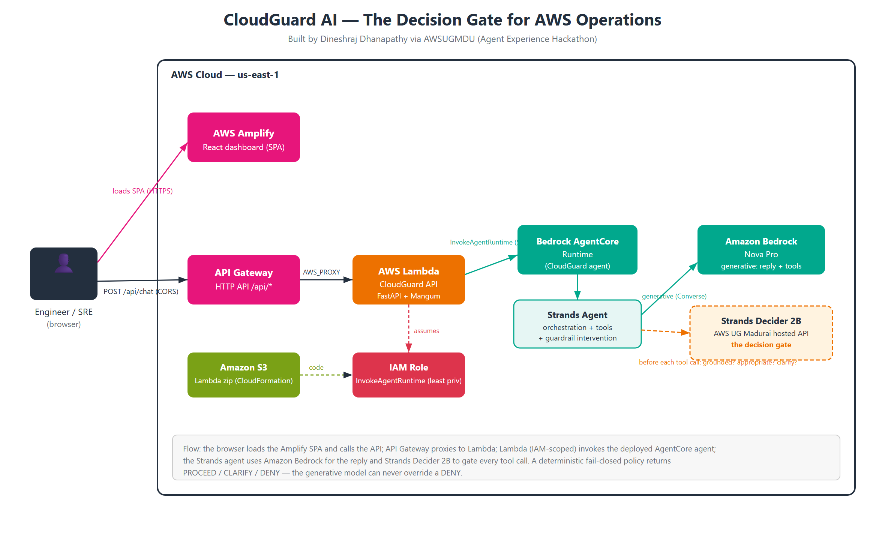
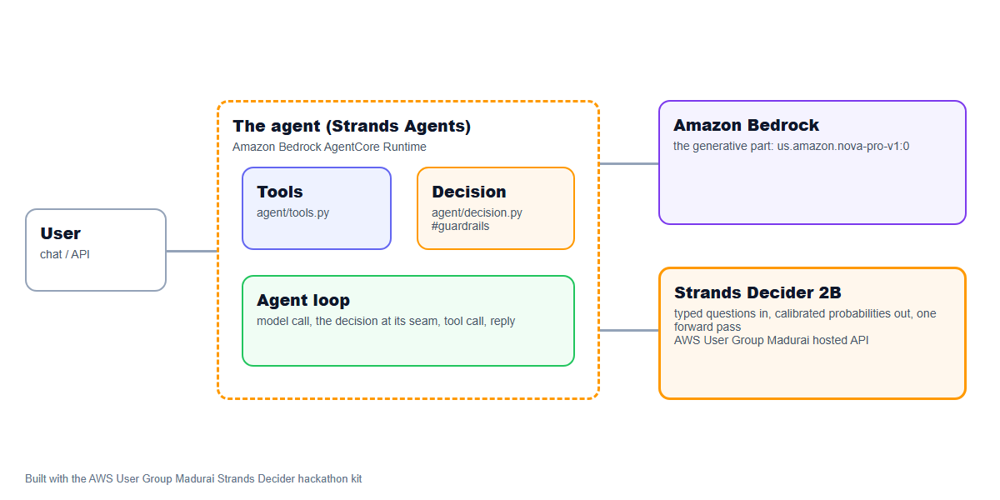

# CloudGuard AI: the decision gate for AWS operations

*Built by Dineshraj Dhanapathy via AWSUGMDU (Agent Experience Hackathon).*

**CloudGuard AI is an AWS operations assistant with a decision gate: before it runs any**

An agent on AWS that hands one decision to **Strands Decider 2B** and the conversation to **Amazon Bedrock**. Decision pattern: `#guardrails`. Tags: `#strands-decider-2b` `#guardrails`.

- Live demo: https://main.d2wslsaw56enrs.amplifyapp.com/
- Repository: https://github.com/dineshrajdhanapathyDD/CloudGuard-AI
<!--- Video: (add the YouTube/Vimeo link)
- Article: (add the AWS Builder Center link)
- Deployed: Amazon Bedrock AgentCore Runtime, us-east-1-->

## Architecture

<!---->


The browser loads the React dashboard from AWS Amplify Hosting and calls a public API (Amazon API
Gateway HTTP API) that proxies to an AWS Lambda. The Lambda, scoped by an IAM role, invokes the
deployed Amazon Bedrock AgentCore runtime. Inside it, the Strands agent uses Amazon Bedrock
(Nova Pro) for the conversation and tool use, and hands every proposed tool call to Strands
Decider 2B (the AWS User Group Madurai hosted API) for the decision. A deterministic, fail-closed
policy turns the decision into PROCEED / CLARIFY / DENY, and the generative model can never
override a DENY.

## The project

- **Pitch:** CloudGuard AI is an AWS operations assistant with a decision gate: before it runs any
  AWS investigation tool, Strands Decider 2B judges whether the call is grounded, appropriate and
  safe, so the agent never acts on invented instance ids or runs an action nobody asked for.
- **Who it is for:** on-call engineers and SREs who want a fast assistant for AWS investigations
  without the risk that an eager agent fabricates arguments or reaches for a destructive action.
- **Features:**
  - investigate EC2 issues through chat: instance details, CloudWatch metrics, alarms, and a
    written summary;
  - every tool call is gated before it runs - grounded read-only calls proceed, ungrounded or
    inappropriate calls are blocked, ambiguous ones ask for clarification;
  - a deterministic, fail-closed safety policy that the generative model cannot override: a
    destructive or unknown tool, malformed arguments, or an unavailable decider never execute;
  - a live decision panel in the demo UI showing the three Decider answers, the confidence, the
    latency, the policy outcome, and the full audit trace;
  - deployed on Amazon Bedrock AgentCore Runtime.
- **The decision handed to Strands Decider 2B:** before an AWS tool call, are its arguments
  grounded in what the user said, is the call appropriate for the request, and is essential
  information missing? (`#guardrails`)
- **Why a decision model:** grounding, appropriateness and "is something missing" are judgements
  over the conversation's language - exactly what an `if` cannot decide. The exact facts (is the
  tool allowed? is it destructive? does the instance id parse?) stay in code and feed the policy.
- **Amazon Bedrock:** the conversation, the tool use, and the human-readable explanation (Amazon
  Nova Pro by default).

Built by Dineshraj Dhanapathy via AWSUGMDU (Agent Experience Hackathon).


## How it is built

Strands Agents with Amazon Bedrock for the generative part, the tools in `agent/tools.py`, deployed to Amazon Bedrock AgentCore Runtime, and one decision handed to Strands Decider 2B at a clear seam in the agent's path.

Every Amazon Bedrock model id is set in `.env` (`BEDROCK_MODEL_ID`, and `BEDROCK_SMALL/MEDIUM/LARGE_MODEL_ID` for routing), Amazon Nova by default.

<!---->

## Reusable decision pattern: aws-operation guardrail gate  (#guardrails)

The pattern lives in [`agent/decision.py`](agent/decision.py), labelled `REUSABLE DECISION PATTERN`. It contains the typed questions and their options, the wiring that puts the decision in the agent's path, and a note on how to reuse it:

```text
REUSABLE DECISION PATTERN: aws-operation guardrail gate  (#guardrails)

What it does
    CloudGuard AI is an AWS operations assistant. Before it runs any AWS tool, this gate hands
    Strands Decider 2B the conversation plus the proposed tool call and asks three narrow,
    language-level judgements:
      - args_grounded:  do the argument values (instance ids, metric names, ...) trace back to
                        what the user actually said or to an earlier verified tool result, or
                        were they invented?
      - appropriate:    is this tool a sensible response to what the user asked for, given the
                        evidence so far?
      - needs_clarify:  is essential information missing, so the agent should ask the user
                        before acting?
    The model only classifies. A deterministic policy (see `policy.py`) combines those three
    probabilities with code-owned facts the decider never sees - whether the tool is even
    permitted, whether it is destructive, and whether the arguments pass structural validation -
    and returns one of PROCEED / CLARIFY / DENY. The policy is fail-closed: a destructive or
    unknown tool, malformed arguments, or a decider that is unavailable or unsure never results
    in the action running.

Typed questions and options
    args_grounded (noul), appropriate (noul), needs_clarify (noul); see QUESTIONS below.

Wiring (where it sits in the agent's path)
    `AWSOperationGuard` is a Strands `InterventionHandler`. agent/agent.py passes it to the Agent:

        Agent(..., interventions=[AWSOperationGuard(Decider())])

    The framework calls `before_tool_call` before every tool runs. Read-only, grounded calls
    PROCEED; a DENY is returned to the model as a hard refusal (Strands `Deny`); a CLARIFY is
    returned as `Guide` so the agent asks the user instead of guessing. If the agent retries the
    exact same guided call unchanged, the retry is denied (Strands requires Guide to converge).
    `before_invocation` clears the per-turn guided set.

How to reuse it
    Copy this file into your own agent. Then:
      1. list your irreversible/destructive tools in DESTRUCTIVE_TOOLS and the tools the agent is
         allowed to use at all in ALLOWED_TOOLS (fail-closed: anything else is denied);
      2. reword the three QUESTIONS for your domain (keep one judgement per question, and
         describe both options - the descriptions carry most of the signal);
      3. keep the facts code already knows (permission, risk, structural validation) in
         `policy.py` and out of the decider;
      4. tune thresholds with `./kit bench` and record the chosen values in `policy.py`.
    Nothing here depends on CloudGuard's tools; the gate is the reusable piece.

This gate is also packaged standalone under `decision_patterns/guardrail_gate/` with its own
README and tests, so another builder can read it without the rest of the app.
```

Typed questions:

```python
QUESTIONS = {
    "args_grounded": Decider.noul(
        "Does every argument value in the proposed tool call appear in the conversation above - stated by the user or returned by an earlier tool?",
        {"true": "each argument value (for example the instance id) is present verbatim in the user's messages or an earlier tool result",
         "false": "at least one argument value does not appear anywhere in the conversation; it was guessed or invented"}),
    "appropriate": Decider.noul(
        "Is this tool an appropriate response to the user's request?",
        {"true": "a read-only investigation (reading instance details, metrics or alarms), or a change the user explicitly asked for",
         "false": "a change or destructive action (restart, stop, terminate, delete) the user did not ask for"}),
    "needs_clarify": Decider.noul(
        "Does essential information have to be clarified with the user before this action can safely run?",
        {"true": "a required detail is missing or ambiguous (which instance? which environment?); ask before acting",
         "false": "everything needed to act is present and unambiguous"}),
}
```

## Measured

Decider: strands-decider-2b-hobson-v19 (ugmdu). 16 labelled cases, 45 decisions.

| | Strands Decider 2B | us.amazon.nova-pro-v1:0 |
|---|---|---|
| Accuracy | 82.2% | 86.7% |
| Latency p50 per decision | 2910 ms | 3081 ms |
| Latency p95 | 3391 ms | 3703 ms |
| Cost per 1,000 decisions | $0.0350 | $0.4740 |
| Answered alone at confidence >= 0.7 | 29% | 100% |
| Accuracy when confident | 92.3% | 86.7% |

At the median the decider was 1.1x faster than the LLM.

### Reading these numbers honestly

On raw accuracy over the held-out split Amazon Nova Pro is ahead by about 5 points (87% vs 82%). Three things matter alongside that, and none of them are spin:

- **Accuracy when confident is the number a guardrail lives by: 92.3% vs 87%.** The gate does not have to answer every call. Below a 0.55 confidence floor it defers (asks the user, or routes to a human) instead of guessing. On the calls it is confident enough to act on alone, it is *more* accurate than the LLM. A guardrail that knows when to abstain beats one that is confidently wrong.
- **Cost is ~13.5x lower: $0.035 vs $0.474 per 1,000 decisions.** The gate runs on *every* tool call, so this compounds. A fleet doing millions of operations pays cents with the decider and dollars with an LLM for the same check.
- **The sample is small and the gap is noise-level.** The held-out split is 16 cases; a 5-point difference is a single case. On the tuning split the decider actually led (90.7% vs 86.1%). We report the held-out numbers as they are and do not cherry-pick the split that flatters us.

The honest weak spots: on the current deployed checkpoint (`hobson-v19`) grounding confidence on clearly-grounded calls sits near the floor (~0.55), and the `summarize_investigation` and "list all alarms" cases are where the decider most often disagrees with the label. The deterministic policy is fail-closed around all of this, so a miss never results in an unsafe action running - it results in a clarify or a deny. Planned improvements: sharper option wording on the two weak questions (tuned on the tune split only), more labelled cases to cut the noise, and evaluating the newer Qwen3.5 decider checkpoint.

Reproduce with `./kit bench` (cases in `agent/eval_cases.jsonl`; charts in `submission/bench/`).

## Run it

```bash
./kit setup        # checks your machine and AWS, sets up Strands Decider 2B (local model or hosted API)
./kit demo         # web UI at http://localhost:8501
./kit bench        # the decision vs an Amazon Bedrock LLM
./kit deploy       # Amazon Bedrock AgentCore Runtime
```

Requirements: Python 3.10+, AWS credentials with Amazon Bedrock access, and for deploying, Node 20+ with the AgentCore CLI (`./kit agentcore-cli`).

## Credits

Built by Dineshraj Dhanapathy via AWSUGMDU (Agent Experience Hackathon).

The CloudGuard AI agent in `agent/` and the reusable gate in `decision_patterns/guardrail_gate/` are by Dineshraj Dhanapathy. Strands Decider: https://github.com/strands-labs/strands-decider (Apache-2.0).

## License

Licensed under the Apache License, Version 2.0 (see LICENSE).

Copyright 2026 Dineshraj Dhanapathy (via AWS User Group Madurai).
